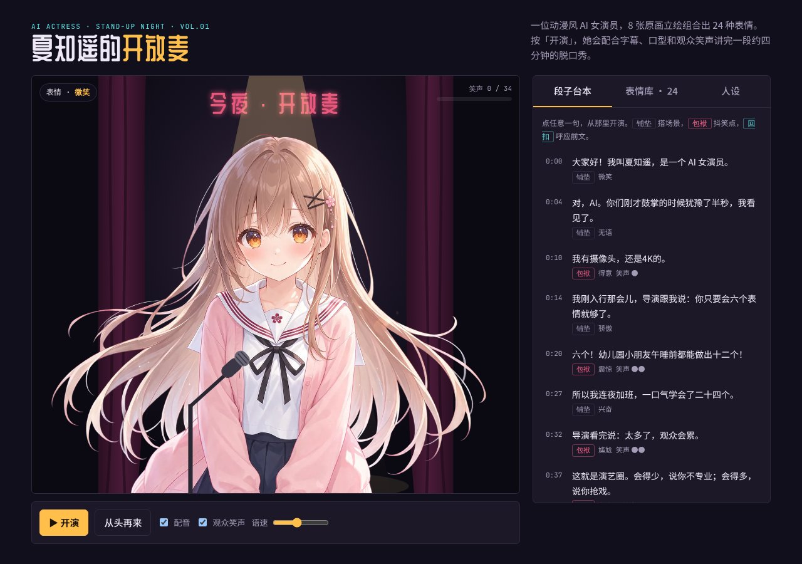

# 夏知遥的开放麦



一位动漫风 AI 女演员，用 8 张原画立绘组合出 24 种表情，外加一段约四分钟的中文脱口秀。网页会自动演出：字幕逐句切换，口型跟着录音开合，会眨眼，包袱落地时有合成的观众笑声，结尾有掌声。

纯静态页面，没有构建依赖。

## 打开方式

直接用浏览器打开 `index.html`，或者在仓库设置里开启 GitHub Pages（Settings → Pages → Deploy from branch → `main` / root）。

- **开演**：从当前句开始播放，再点一次暂停。
- **段子台本**：点任意一句，从那里开演。每句标了 铺垫 / 包袱 / 回扣，以及预期笑声强度。
- **表情库**：24 个表情的缩略图，点击即可预览。
- **配音**：播放预先合成好的录音 `voice/NN.mp3`，嘴型跟着录音的音量开合。录音加载失败时退回浏览器语音（Web Speech API），再不行就只显示字幕。

## 在微信里播放

微信内置浏览器（安卓 XWeb/X5、iOS WKWebView）基本不支持 `speechSynthesis`，所以每句台词都提前合成成了 MP3，页面里用 `<audio>` 播放：

- 点「开演」时，页面在这次点击里先静音播一下 `<audio>` 来解锁。iOS 和微信只允许点击过的音频元素在之后自动播放下一句。笑声用的 `AudioContext` 也在同一次点击里 `resume()`。
- 页面监听 `WeixinJSBridgeReady`，提前 `load()` 音频。
- 切到后台时自动暂停。
- 需要通过 HTTP(S) 打开，例如 GitHub Pages。直接双击本地文件时，`fetch` 读不到 `voice/voice.json`，会退回浏览器语音或字幕模式。

修改台本后重新生成录音：

```sh
pip install sherpa-onnx numpy   # 另需 ffmpeg 和 node
curl -LO https://github.com/k2-fsa/sherpa-onnx/releases/download/tts-models/kokoro-multi-lang-v1_0.tar.bz2
tar xjf kokoro-multi-lang-v1_0.tar.bz2
python3 tools/render-voice.py --model kokoro-multi-lang-v1_0
```

语音模型是 Kokoro v1.0 多语种版（Apache-2.0），音色为 `zf_xiaoxiao`（sid 47）。

## 角色设定

| 项目 | 内容 |
| --- | --- |
| 名字 | 夏知遥 Xia Zhiyao |
| 身份 | AI 女演员，出道 v1.0，现役 v3.7 |
| 外形 | 浅棕色及腰长发，琥珀色眼睛；粉色针织开衫配白色水手服、黑色领结和深蓝百褶裙 |
| 辨识点 | 右侧刘海上的 X 形发夹和樱花发饰，书包上挂着一粉一蓝两个小玩偶 |
| 性格 | 嘴硬心软，爱自嘲，喜欢拿算力和 token 开玩笑 |

## 立绘与表情

立绘是 8 张同一姿势的全身图（1664×2496 透明 PNG，原文件名 `mio_01_smile_01.png` 到 `mio_08_closed_01.png`）：微笑、大笑、害羞、惊讶、嘟嘴、难过、思考、闭眼。舞台只显示上半身。

因为 8 张图的姿势一致，可以从一张图里裁下局部、羽化边缘后叠到另一张上：

- **眨眼**：用「闭眼」图的眼睛，每隔 2–5 秒盖上约 140 毫秒；只盖右眼就是「眨眼」和「坏笑」。
- **说话**：用「惊讶」图的小圆嘴，录音音量超过阈值时盖上，口型跟着声音开合。
- **切换**：两层立绘交叉淡入，约 0.18 秒。

24 种表情是立绘加特效、歪头和颤抖的组合：

| 表情 | 立绘 | 叠加 |
| --- | --- | --- |
| 平静 / 无语 / 翻白眼 / 困惑 / 思考 | 思考 | 无语、翻白眼：省略号；困惑：问号；思考：思考泡泡 |
| 微笑 / 得意 / 尴尬 / 眨眼 / 坏笑 | 微笑 | 得意、坏笑：星光；尴尬：汗滴和阴影线；眨眼、坏笑：闭右眼 |
| 大笑 / 兴奋 | 大笑 | 兴奋：星光和感叹号 |
| 害羞 / 心动 | 害羞 | 心动：飘爱心 |
| 惊讶 / 震惊 | 惊讶 | 震惊：阴影线和感叹号 |
| 委屈 / 生气 | 嘟嘴 | 生气：怒气符号 |
| 失落 / 大哭 / 紧张 | 难过 | 失落：阴影线；大哭：眼泪和颤抖；紧张：汗滴和颤抖 |
| 憋笑 / 犯困 / 骄傲 | 闭眼 | 憋笑：颤抖；犯困：Zzz；骄傲：星光 |

更换立绘后重新生成素材：

```sh
python3 tools/prepare-art.py path/to/expr   # 需要 Pillow
```

脚本把每张图裁成上半身、缩到 1280 像素宽、转成 WebP（每张约 205 KB，8 张共约 1.6 MB），再切出眨眼和张嘴用的补丁。补丁的位置写在脚本的 `PATCHES` 里；换了姿势不同的立绘，需要重新量这几个框。

## 脱口秀

台本见 [docs/standup.md](docs/standup.md)。主题是一个 AI 女演员的职场吐槽：导演只要六个表情、没有童年、按 token 计费的感情、甲方要的「高级感」，以及 AI 说错话叫「幻觉」。结尾回扣开场的「犹豫半秒」和「观众会累」。

## 目录

```
index.html      发布用页面（由 build.sh 生成）
src/app.html    页面源码：样式、舞台、表情数据、台本、演出逻辑
build.sh        把 src/app.html 包成完整 HTML
docs/standup.md 脱口秀台本
voice/          每句台词的 MP3 和口型音量数据（voice.json）
tools/render-voice.py  离线合成录音的脚本
art/            立绘 WebP 和眨眼、张嘴补丁
tools/prepare-art.py   从原始 PNG 生成 art/ 的脚本
```

修改 `src/app.html` 后运行 `./build.sh` 重新生成 `index.html`。

## 参考

演出控制台和「角色 + 表情 + 短剧」的形式参考了 [c-c-15-codex-beauty-actor](https://github.com/ssttmkkw-hue/c-c-15-codex-beauty-actor)。本项目的表情组合方式、演出逻辑和台本都是重新设计的。立绘由项目作者提供。
